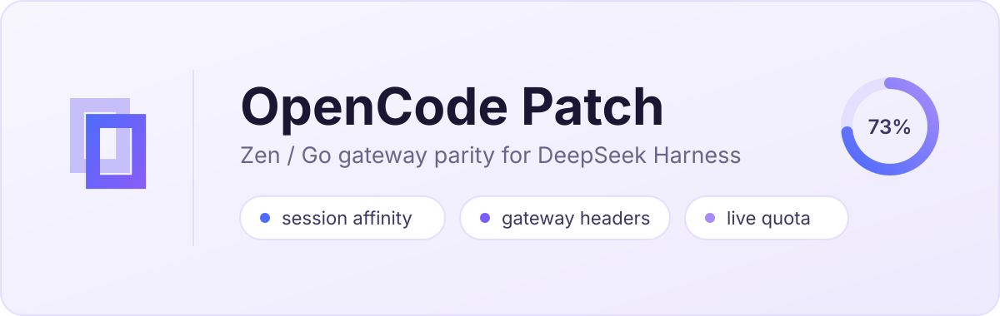

<div align="center">
  <p><a href="./README.md">English</a> &nbsp;·&nbsp; <b>简体中文</b></p>

  <p></p>

  
  <h1>dsh-opencode-patch</h1>
  <p><b>OpenCode on DeepSeek Harness</b><br />网关来源头 · 会话亲和 · 免费层工具回退 · 实时双模式额度计量</p>

  <p>
    <a href="https://www.npmjs.com/package/dsh-opencode-patch"></a>
    <a href="https://www.npmjs.com/package/dsh-opencode-patch"></a>
    <a href="https://github.com/viztor/dsh-opencode-patch/actions/workflows/ci.yml"></a>
    <a href="https://github.com/viztor/dsh-opencode-patch/actions/workflows/release.yml"></a>
    <a href="https://github.com/viztor/dsh-opencode-patch/blob/main/LICENSE"></a>
    <a href="https://nodejs.org"></a>
    <a href="https://www.typescriptlang.org"></a>
    <a href="#-quick-start"></a>
    <a href="#-quick-start"></a>
    <a href="./CONTRIBUTING.md"></a>
  </p>

  <p>
    <a href="#-快速开始">快速开始</a> ·
    <a href="#-修复的问题">修复的问题</a> ·
    <a href="#-界面">界面</a> ·
    <a href="#-配置参考">配置</a> ·
    <a href="#-故障排查">故障排查</a> ·
    <a href="./CHANGELOG.md">更新日志</a> ·
    <a href="./CONTRIBUTING.md">贡献指南</a>
  </p>
</div>

---

`dsh-opencode-patch` 是一个 DeepSeek Harness 宿主插件，让 **OpenCode Zen 与 Go** 模型在 DSH 内持续可用。无需遭遇网络拒绝、Cloudflare 挑战、权益不匹配或隐形限制，即可接入 `claude-sonnet-4-5`、`gpt-5.4`、`gemini-3.8-flash`、`deepseek-v4.1-flash`、`muse-spark-1.3`、`qwen3.8-flash` 以及 OpenCode 目录中的其余模型。

**默认状态。** 把 DSH 直接指向 OpenCode、不装任何插件，模型是**完全不能用**的——不是某一种形状不能用，而是全部：

- **请求不会被识别为"编码 agent"发出的。** DSH 发的是自己的 `User-Agent`，不带 `x-opencode-client`、`x-opencode-project`，也不带 `x-opencode-session`；网关看到的就是一次匿名 SDK 调用，流量要受厂商对"不表明身份的客户端"所设的滥用规则约束。**免费层是另一回事，原因也不在这里**：把这些请求头全部恢复、换上 CLI 的 `User-Agent`、带上有效的会话 id 以及回退注入的 `read`/`bash` 工具定义之后，在 OpenCode 之外调用 Zen 的 `-free` 模型仍然返回 `403 FreeTierError`，而同一个请求换成付费模型返回 `200`。这些 id 依然会列出——拒绝本身会说明原因，而把厂商可能仍在服务的模型藏起来是更糟的失败——补丁恢复的请求头服务于付费路由以及厂商声明的客户端规则。
- **没有会话 id 的一轮会被拒、或失去关联。** 每一轮都必须带一个稳定的 `ses_…` 形状的 id，而 DSH 在子代理、后台评估以及 **Auto Review** 这类模式下会完全省略 `sessionId`。
- **免费层的 `/responses` 请求体缺少 `read` 与 `bash` 会被拒**，而 DSH 是刻意不发这两个工具的。
- **目录很单薄。** 裸 `/models` 列表只有 id，几乎没有别的信息，所以选择器里是一堆没有名字、没有价格、没有上下文窗口的行。

**这些能用之后剩下的**是另一个问题，而且与账号无关：OpenCode 的模型分布在**四种不同的 API 形状**上，而 DSH 是按 provider 行选择传输协议的——一条路由只能说一种形状。所以走 Responses / Messages / Mistral 的模型在基础问题解决之后就会返回 `500`。这正是插件**按模型而不是按 provider** 路由的原因。

插件自己服务两条 OpenCode 路由——`opencode` 与 `opencode-go`，每个模型都走目录指定的协议——并在网络层补齐所有缺失的协议要素，**且仅针对这两条路由**。其余全部流量（DeepSeek、OpenAI、Anthropic、GitHub）原样通过。

**三条主线。**

1. **最小侵入。** 不做全局补丁：只拦截本插件声明的路由，其他厂商——DeepSeek、OpenAI、Anthropic、GitHub——的请求原样通过。计量器离"彻底消失"只差一个开关，而不是离"勉强忍受"隔着一个页面。
2. **原生 DSH 插件。** 一个 `apply()`、一张绑定自己命名空间的设置卡、用 `ctx.inject` 声明服务、按宿主自己的方式填充插槽，文案随宿主语言切换。没有私有钩子，不改宿主代码。
3. **OpenCode API 兼容。** 网关真正检查的那些特征在网络层还原——与 CLI 同形状的 `ses_…` 会话 id、官方来源头、父会话血统，以及免费层的 `read`/`bash` 工具 schema 回退。

**亮点**

- 🔑 确定性的 `ses_<12hex><14base62>` 会话哈希，跨轮次、子代理与分叉保持 KV 缓存亲和
- 🌐 网关来源恢复——`User-Agent`、`x-opencode-client`、`x-opencode-project`、父会话谱系
- 🧰 免费层 `read` + `bash` 工具 schema 回退，让免费层的请求体带上它的端点所要求的工具定义——这去掉的是 `403` 的一个成因，而不是全部：网关的那道闸不在请求里，实测如此
- 📇 基于 OpenCode 官方目录（`models.opencode.ai`，即 models.dev 发布的那份注册表）的模型目录，带离线预置与后台 SWR 刷新——名称、上下文窗口、价格
- ⭕ 实时双模式停靠栏计量——Go 额度环（5 小时 / 每周 / 每月）或 Zen 按量计费胶囊，外加会话消耗与模型费率
- 🕵️ Go 计量凭据防护——Go 额度端点绝不会收到 `OPENCODE_API_KEY` 引用；它读取 Go 条目的 `apiKeyEnv`（否则 `OPENCODE_GO_API_KEY`），或某次 Go 平面请求携带的密钥

**目录**

1. [快速开始](#-快速开始)
2. [修复的问题](#-修复的问题)
3. [支持的模型与协议](#-支持的模型与多协议路由)
4. [界面](#-界面)
5. [配置参考](#-配置参考)
6. [移除或停用插件](#移除或停用插件)
7. [故障排查](#-故障排查)
8. [1.x 变更](#1x-变更)
9. [兼容性与验证](#-兼容性与验证)
10. [深入解析](./docs/deep-dive.md) — 协议内部实现，已移出本 README
11. [署名与许可](#-署名与许可)

---

## 🚀 快速开始

**1. 安装**到你的 DSH Web profile（Node 24+）：

```sh
cd ~/.dsh/profiles/web
npm install dsh-opencode-patch
```

包名在所有用到它的地方都是 `dsh-opencode-patch`：你安装的依赖、profile 里的 bundle 条目，以及宿主解析的那一行。它也以 [`@viztor/dsh-opencode-patch`](https://www.npmjs.com/package/@viztor/dsh-opencode-patch) 发布，而旧名 [`@viztor/dsh-opencode`](https://www.npmjs.com/package/@viztor/dsh-opencode) 继续以**已弃用的薄包装**发布、转导出本包——仍在使用旧名的安装照常可用，换到另外两个名字只是改名，不是修问题。

**2. 启用 bundle**——把该包加入 profile 的 `dsh.profile.bundles` 数组：

```jsonc
// ~/.dsh/profiles/web/package.json
{
  "dependencies": {
    "dsh-opencode-patch": "^1.8.0",
  },
  "dsh": {
    "profile": {
      "bundles": ["dsh-opencode-patch"],
      "patchReload": "live",
    },
  },
}
```

**3. 添加凭据**，让额度计量能解析到密钥——在 DSH Credentials 或你的环境变量中存储 `OPENCODE_GO_API_KEY`（Go 订阅，`sk-…`）和/或 `OPENCODE_API_KEY`（Zen 按量计费，`oc_sk_…`）。**在 Go 平面上要写明它：** 给 `opencode-go` 条目加上 `apiKeyEnv: OPENCODE_GO_API_KEY`。没有 `apiKeyEnv` 的平面条目按 pi 自己的查找认证，而它在两个平面上读的都是 `OPENCODE_API_KEY`，所以没有写明的 Go 条目发送的是 Zen 密钥。

**4. 重启 `dsh web`。** 宿主 bundle 只在启动时导入（`hmr root: []`），因此要重启才会加载 `lib/index.mjs`；客户端 UI 变更（`lib/client.js`）只需刷新浏览器。

完成——**OpenCode 补丁设置**卡片会出现在 _Settings → Plugins_ 下，一旦有 OpenCode 模型激活，计量表就会挂载到输入框停靠栏。

---

## 🔌 修复的问题

| 没有补丁时 | 使用 `dsh-opencode-patch` 后 |
| :-- | :-- |
| Zen 免费模型报 `403 FreeTierError` | **照常列出，由网关用自己的话拒绝。** 请求头与工具回退会为付费路由恢复，但它们不是这个错误的原因——在全部就位的情况下实测，Zen 的 `-free` id 仍返回 `403`，而付费模型返回 `200`；拒绝来自控制台背后的服务，而不是请求携带的任何内容。所以这些 id 留在选择器里，拒绝以 `400 free_tier_restricted` 呈现，而不是变成一行被隐藏的模型 |
| 一条路由只能说一种形状——基础问题解决后，其余模型返回 `500` | **逐模型路由**——按目录里每个模型自己声明的 SDK 派发到对应端点 |
| 会话 ID 被拒并返回 `400 MissingSessionID` | **确定性的 `ses_…` 会话哈希**与跨轮次亲和 |
| 子代理丢失对话上下文 | **父会话跟踪**（`x-opencode-parent-session-id`、`x-parent-session-id`） |
| Auto Review 调用报 `TRANSPORT: Connection error` | **回退会话轮次捕获**，在评估调用之间保留轮次状态 |
| 额度与余额不可见 | **实时双模式停靠栏计量**，显示 Go 额度或 Zen 按量计费 |
| Zen 密钥在 Go 用量上触发 `403 EntitlementError` | **计量绝不为 Go 读取 `OPENCODE_API_KEY` 引用。** 它依次使用：Go 条目上的字面 `apiKey`、Go 平面请求捕获到的密钥、Go 条目的 `apiKeyEnv`（`OPENCODE_API_KEY` 引用按 `OPENCODE_GO_API_KEY` 读取）、任意捕获的 Go 平面密钥，最后是需显式开启的安装存储。Go 回合携带其条目所写明的密钥；没有写明的条目发送 pi 的 `OPENCODE_API_KEY`，请求补丁把它当作 Go 密钥记录，于是从第一次 Go 回合起计量就把它发往 Go 用量端点并得到这个 `403`。在 Go 条目上写明 `apiKeyEnv: OPENCODE_GO_API_KEY`，让回合与计量一致；或在 Settings 中把凭据来源设为“优先已声明密钥” |
| 所有项目共用一个 `"global"` 遥测桶 | **动态工作区归属**，由当前 `session.header.cwd` 解析 |
| 网关 `/models` 返回截断且无名称的列表 | **目录补全**（`models.opencode.ai`）：显示名、上下文窗口与价格 |

---

## 🧭 支持的模型与多协议路由

**每个平面一条路由，所有协议都在这条路由上。** 插件用自己的适配器服务 `opencode`（Zen）和 `opencode-go`（Go）——它是宿主自带 `llm-pi-ai` 适配器的子类，通过宿主自己的 `registerAdapter` 注册在宿主的 `llm` 服务上。你声明的其他路由仍由 `llm-pi-ai` 服务。每个模型按其目录行指定的协议派发，所以没有第二条路由需要声明、挂载或隐藏。

网关提供四种线路家族，而 **OpenAI 自己就占了两种**：Chat Completions 与 Responses 是**两种不同的线路格式**，不是同一个东西的两个名字。需要 Responses 的模型在 completions 端点上不工作，而网关**不会回退**——它直接返回 `500`。四种都由 pi 自己的协议实现服务。

**两个端点家族。** OpenCode 在两个分别授权的家族上应答。**modern**——默认值，也是 `endpoint: auto` 的含义——是目录指定的逐协议推理家族：Zen 为 `https://opencode.ai/inference/{openai,anthropic,google}/…`，Go 为 `https://opencode.ai/inference/go/{openai,anthropic,google}/…`。**legacy**（`endpoint: legacy`）是每个平面一个基址的旧家族：`https://opencode.ai/zen/v1` 与 `https://opencode.ai/zen/go/v1`。平面条目上的 `baseURL` 按其路径选择家族，其他主机按原样使用。

这些端点的认证有**三种**，因为它们说三种线格式：OpenAI 平面发 `Authorization: Bearer <key>`，Anthropic 平面发 `x-api-key: <key>`，Google 平面发 `x-goog-api-key: <key>`。

### 1. OpenCode Zen (`provider: opencode`) — 按量计费与免费额度

- **Anthropic Messages** (`https://opencode.ai/inference/anthropic/v1/messages`)：`claude-sonnet-4-5`、`claude-opus-4-7`、`claude-haiku-4-5`、`qwen3.8-flash`
- **OpenAI Responses** (`https://opencode.ai/inference/openai/v1/responses`)：`gpt-5.4`、`gpt-5.2`、`gpt-5.1-codex-max`、`muse-spark-1.3`、`grok-4.7`、`muse-wonder-1.0`
- **OpenAI Chat Completions** (`https://opencode.ai/inference/openai/v1/chat/completions`)：`deepseek-v4.1-flash`、`kimi-k2.5`、`kimi-k3`、`minimax-m2.5`、`glm-5.2`，外加免费层的 `mimo-v2.6-flash-free`、`nemotron-3.5-lightning-free`、`deepseek-v4.1-flash-free`
- **Google Generative AI** (`https://opencode.ai/inference/google/v1beta/models/*:streamGenerateContent`)：`gemini-3.8-flash`、`gemini-3.1-pro`、`gemini-3.5-flash-lite`

### 2. OpenCode Go (`provider: opencode-go`) — 订阅额度

- **OpenAI Chat Completions**（`https://opencode.ai/inference/go/openai/v1/chat/completions`）：`beam-free`, `deepseek-v4-pro`, `deepseek-v4.1-flash`, `glm-5.2`, `glm-5.3`, `glm-5.3-flash`, `hy3`, `hy4`, `hy4-preview`, `iceman-contributor-free`, `kimi-k2.7-code`, `kimi-k3`, `kimi-k3.1-pro`, `longcat-2.0`, `longcat-2.5-free`, `mimo-v2.5`, `mimo-v2.5-pro`, `mimo-v2.6-flash`, `mimo-v2.6-pro`, `minimax-m3.1-flash`, `step-5-preview`
- **OpenAI Responses**（`https://opencode.ai/inference/go/openai/v1/responses`）：`gpt-5.6-luna`, `gpt-6-luna`, `grok-4.7`, `muse-spark-1.2-contributor`, `muse-spark-1.3-contributor`
- **Anthropic Messages**（`https://opencode.ai/inference/go/anthropic/v1/messages`）：`claude-haiku-5-5`, `minimax-m3`, `qwen3.7-plus`, `qwen3.8-flash`, `qwen3.8-max`
- **Google Generative AI**（`https://opencode.ai/inference/go/google/v1beta/models/*:streamGenerateContent`）：`gemini-4-argon`，支持图片附件和带签名的工具调用回放。Go 没有旧版 Google 接口，因此两个家族都使用这一个地址。
- 由实时三窗口额度计量监控（5 小时滚动、每周、每月）。完整集合随内置目录发布——参见[权威模型目录](#7-权威模型目录双本地预置--实时-swr-更新)。

### 3. 模型的协议是怎么定的 —— 以及为什么你什么都不用配

Zen 的 provider 级 SDK 是 `@ai-sdk/openai-compatible`。models.dev **只在该模型需要不同 SDK 时**才逐模型标注 `provider.npm` —— 所以这个字段的**存在本身就是信号**，它决定走哪条线路协议。没有任何手工匹配：

| models.dev `provider.npm` | 模型数 | 协议 |
| :-- | --: | :-- |
| _（缺失）_ | 27 | OpenAI Chat Completions |
| `@ai-sdk/openai` | 32 | OpenAI Responses |
| `@ai-sdk/anthropic` | 18 | Anthropic Messages |
| `@ai-sdk/google` | 10 | Google Generative AI |
| `@ai-sdk/mistral` | 1 | OpenAI Chat Completions（与 pi 自己的数据一致） |

数量为 `models.opencode.ai` 中 `opencode` 的 88 个**在用**模型，统计于 2026-11-13 —— 其余已废弃或下架，补丁只内置网关仍在服务的部分。同样这 88 个模型离线内置在 `src/catalog-data.ts`，因此在第一次 catalog 刷新之前它们每一个路由都是正确的；用 `pnpm run catalog:shim -- --write` 重新生成该文件（不加 `--write` 时只做检查）。

由此有四条性质：

- **你的挑选仍然有效。** 每个平面服务的正是其 `llm-pi-ai` 条目列出的模型；条目没有列出任何模型时，服务整个目录。在**用 OpenCode 官方目录补全列表**开启时（默认），Settings → Models → Fetch 提供整个目录：pi 自己的列表，加上目录里 pi 未列出的每个可服务、未下线的模型。它提供的每一行带的是目录的名称、上下文窗口、输出上限与模态——即输入框所服务的值——只有目录没有时才用 pi 的；从中采纳的模型与其他 id 一样保存，并由插件服务。你保存的任何 id 都会被接受并服务：目录未归类的 id 按 Chat Completions 发送，除非平面条目指定了路由级的 `api`——它只作用于这类 id。pi 自己的目录从不决定协议或地址，所以 pi 升级即使改写了它，也不会移动任何回合。
- **你的模型行优先。** 模型的名称、上下文窗口、输出上限与输入模态，先取你自己的模型行，再取目录，最后取 pi 的内置数据。推理档位先取你行里的 `reasoningEfforts`，再取目录。价格与协议不是模型行的字段：价格先取目录、再取 pi；协议先取目录的 SDK，再取平面条目的路由级 `api`（仅用于目录未归类的 id），最后为 Chat Completions。
- **只有开/关两种推理的模型提供“关 / 开”。** 只有该模型的协议确实能关闭推理时才提供“关”；有真正档位列表的模型只提供它自己的档位；档位列表中含 `none` 的 Chat Completions 模型同样提供“关”，按 pi 自己条目的写法发送 `reasoning_effort: "none"`。
- **一份凭据，按宿主自己的规则。** 平面的认证方式与 `llm-pi-ai` 相同：条目的 `apiKeyEnv` 经凭据服务解析（未挂载凭据服务时读启动环境），保存在 `llm-pi-ai/opencode` 下的登录记录，否则用 pi 自己的 `OPENCODE_API_KEY` 查找——两个平面读的是同一个变量：请在 Go 条目上写明 `apiKeyEnv: OPENCODE_GO_API_KEY`。只有在没有声明引用、且部署选择开启时，才会读取 OpenCode 安装自己的存储。密钥解析不到的平面仍列出其模型，回合在发出任何请求前以 `MISSING_CREDENTIAL` 失败。

**设置仍归宿主所有。** 平面条目一如既往留在 `llm-pi-ai` 的 `providers` 块里，_Settings → Models_ 也在那里读写它们。插件把去掉这两个平面的配置副本交给 `llm-pi-ai`，让它不服务这两个平面；并用 `llm-pi-ai` 自己的检查校验对平面的设置编辑，所以格式错误的条目会在写入前被拒绝。

### 4. 覆盖的执行模式

| 模式 | 补丁做什么 |
| :-- | :-- |
| **交互式多轮对话** | 通过每会话稳定的 `ses_…` id 提供 KV 提示缓存亲和 |
| **子代理与分叉** | 子、父会话都参与哈希；谱系由父级请求头携带 |
| **Agent 团队** | 跨编排轮次保留共享工作区的归属信息 |
| **实验性 Auto Review** | 即使后台审计调用省略 `sessionId`，仍会得到确定性的轮次状态、请求头与工具回退——而且它们的路由取自会话，所以会话正在用哪个模型，它们就跑哪个模型 |

---

### 5. 目录：合并了什么，谁说了算

模型清单由四个来源拼成，每个来源回答的是不同的问题：

| 来源 | 回答 |
| :-- | :-- |
| 内置 shim | 一次网络请求都还没有时能提供什么——冷启动、离线 |
| `models.opencode.ai` | 规范参数、价格与显示名 |
| 网关的 `/models` | **这个账号**实际能用什么 |
| 设置的获取（`discoverModels`） | 在 `opencode`/`opencode-go` 上：先是 pi 自己的列表，再是 pi 缺少的每个目录模型 |

合并是**增量式**的：适配器给的行保留，规范行只在缺失时追加，只有当目录（registry）把某个模型标为 `status: "deprecated"` 时才省略它——那是事实，不是猜测。显示名与价格取自目录（`models.opencode.ai`），因为网关列表只给 id，别的几乎没有。

有两点你在使用中会注意到。**冷启动永远不为空**——内置 shim 在第一次刷新前就能回答，选择器立刻有模型可选。而且**目录里没有条目的模型照样出现**，费率位置显示 `—`：既不猜，也不会退回去显示上一个模型的名字。

两个生成文件都在 CI 里校验（`catalog:shim`、`limits:shim`）；厂商数据变动时它们以非零码退出——这是唯一能发现厂商注册表在你背后变了的办法。只有当拉取请求改动了生成该文件的代码时，CI 才会因此失败；否则只给出警告，由每晚的任务以单独的拉取请求提出刷新。

→ 协议路由、合并与界面的技术细节： [`docs/protocol-routing-and-merge.md`](./docs/protocol-routing-and-merge.md) · [English](./docs/protocol-routing-and-merge.md)

## 🖥 界面

两个界面，同一个读数。两者都是纯视图，数据来自宿主。

| 界面 | 位置 | 显示什么 |
| :-- | :-- | :-- |
| **计量表触发按钮** | 输入框停靠栏，模型选择器旁 | Go：圆环 + 该窗口的百分比。Zen：本会话消费额，**不画圆环** |
| **计量表面板** | 点击触发按钮 | 三个窗口、月度额度、本会话消耗、Zen 余额、操作链接 |
| **设置卡片** | _Settings → Plugins → OpenCode 补丁设置_ | 九个控件，上方另有一份实时 Go 用量摘要 |

悬停触发按钮解释它自己的数字；点击打开面板。下面逐节展示每个界面，逐状态的行为见 [docs/quota-meter.zh-CN.md](./docs/quota-meter.zh-CN.md)。

### 设置卡片 — _Settings → Plugins → OpenCode 补丁设置_

四个分区共九个控件——都是用户真正会做出的决定。所有控件都基于平台自身的原语渲染（`Switch`、`Tag`、`Button`、宿主 token），每个配置项都带提示以及恢复默认的操作。

| 分区 | 控件 | 默认 | 作用 |
| :-- | :-- | :-: | :-- |
| **网关请求** | 恢复 User-Agent（默认开启） | `on` | 恢复官方 OpenCode CLI 的 `User-Agent`，使 Cloudflare WAF 校验通过 |
| **网关请求** | 注入客户端来源头（默认开启） | `on` | 在网关流量上注入 `x-opencode-client`（以及来源请求头集合） |
| **网关请求** | 附带工作区项目标识（默认开启） | `on` | 用当前文件夹名标记 `x-opencode-project`；关闭则省略该请求头 |
| **模型与免费额度** | 用 OpenCode 官方目录补全列表（默认开启） | `on` | 让网关 `/models` 列表带上完整目录，并把目录提供给设置页的模型发现。本身**不会**往选择器里添加模型——选择器显示你声明的模型；条目未声明任何模型时显示该平面的目录，此开关不改变这两者。要声明更多，请在 OpenCode 平面上使用 **Settings → Models → Fetch**：它会提供 pi 的列表以及 pi 缺少的目录模型，选用一行并保存即完成声明。已声明模型自身的信息（上下文、模态、思考档位）始终来自你的模型行与目录，与此开关无关 |
| **模型与免费额度** | 自动补全核心工具（默认开启） | `on` | 补上免费层 `/responses` 与 Chat Completions 请求体所需的 `read` + `bash` schema，替换以空 schema 声明的 `read` 或 `bash`，并给没有自带工具的免费 Chat Completions 请求体加上 `tool_choice: "none"` |
| **配额计量** | 开启输入区用量计量（默认开启） | `on` | 在输入框停靠栏挂载实时计量表——Go 额度环，或 Zen 会话消耗 |
| **账户与端点** | API 端点 | `auto` | 请求发往哪个端点家族：**自动**（同新端点） · **旧端点**（`zen/v1`、`zen/go/v1`） · **新端点**（按协议的 `inference/{openai,anthropic,google}/…`，Go 为 `inference/go/…`） |
| **账户与端点** | 凭据来源 | `auto` | 多个密钥同时可用时以哪个为准：**自动** · **优先实时请求** · **优先已声明密钥** |
| **账户与端点** | 读取 OpenCode 安装版的密钥（默认关闭） | `off` | 允许本插件读取 OpenCode 自己保存的凭据，且仅作最后手段——默认关闭 |

### 选择端点与凭据

一个请求发往哪里由两个问题决定，答案就在**账户与端点**分区里。

**发往哪个端点家族。** 网关在两套端点上都应答——较早的 `/zen/v1`（Go 为 `/zen/go/v1`），所有协议共用一个基址；以及较新的按协议划分的 `inference` 家族（`/inference/openai/v1`、`/inference/anthropic/v1`、`/inference/google/v1beta`，Go 为 `/inference/go/…`）——而两者的授权是**彼此独立**的：在一边可用的账户不保证在另一边可用。`modern` 将每个协议发往各自的 inference 路径；`auto`（默认值）是 `modern` 的别名；`legacy` 固定使用较早的一套，适用于账户只在那里可用的情况。

**以哪个凭据为准。** 平面上的回合按宿主自己的规则认证（见[模型的协议是怎么定的](#3-模型的协议是怎么定的--以及为什么你什么都不用配)）。对额度计量与请求补丁而言，`keySource` 决定插件可见的多个凭据源的优先级——`auto` 优先使用你声明过的密钥，其次是从实时请求中捕获的密钥，最后是声明的凭据引用；`request` 把捕获到的密钥提到最前；`configured` 则相反。其下的 `readOpencodeStore` 允许插件读取 OpenCode 自己保存的凭据，且**仅作最后手段**。两者默认分别为 `auto` 与关闭，因此在你说要改之前一切照旧。

覆盖类配置项（字面字符串、标记、路由列表）刻意只留在配置里，让默认值适用于所有有文档记载的配置——参见[配置参考](#-配置参考)。

卡片在控件上方还带一份**实时的 Go 用量摘要**——和输入框计量表同一个读数，但用官方控制台的排版：每个窗口一行，**剩余**单独放在右侧。

```
Go 用量                                             状态正常
● 5 小时   0% 已用 · 4小时58分钟后重置              100% 剩余
● 每周    28% 已用 · 3天2小时后重置                  72% 剩余
● 每月    14% 已用 · 11月7日8点55分重置              86% 剩余
月度额度  mimo-v2.6-flash · Go $60 · Plus $120            ⓘ
```

**这个版本只带 API 密钥路径。** 没有登录行，也没有设备流：凭据来自部署的配置、来自从实际请求中捕获的密钥，或者——在开启 `readOpencodeStore` 时——来自 OpenCode 安装自身的存储。Console 登录（设备流、会话存储、凭据池）在 `v2` 线上，刻意不放进 `main`，因此这里不依赖宿主可能没有挂载的服务。

**如果更新后卡片看起来还是上一版，说明宿主进程没有重启。** 宿主包只在进程启动时读取一次，所以浏览器刷新仍在运行上一版的 `lib/index.mjs`；请停止并重启 `dsh web`。这一行是最快的判断办法，因为它和其他所有改动在同一个版本里新加入。

「剩余」是百分比，不是美元数：`/usage` 每个窗口只给一个百分比、完全没有余额接口，而套餐档位也无法探测——任何美元余额都会是猜的。这一点由 ⓘ 说明。读不到配额时它明说读不到，并且不打印任何数字，而不是打一排会被当成真实读数的 `0%`。

### 输入框停靠栏计量表

计量表挂载在 `conversation.composer.dock` 中 DSH 原生 `ContextMeter` 旁。逐状态的行为说明（触发按钮的三种状态、两个面板、每一行的含义、三种「没有数字」的区别）见 [`docs/quota-meter.zh-CN.md`](./docs/quota-meter.zh-CN.md)。

```
┌─────────────────────────────────────────────────────────────────┐
│ Type a message...                                               │
│                                                                 │
│ [+] Attach                            [DeepSeek V4.1 Flash ⌄] [⬆]│
└─────────────────────────────────────────────────────────────────┘
   [ ⭕ 73% Context ]   [ ⭕ 42% Go Quota ]   ← when OpenCode Go is active
   [ ⭕ 73% Context ]   [ ⭕ $0.00 ]            ← 使用 OpenCode Zen 时
```

#### 模式 A — OpenCode Go (`opencode-go`)

- **自适应环**：实时 SVG 环，显示能回答问题的那个窗口。**已经用尽**的窗口——受限或到达上限——优先显示，从宽到窄（每月 → 每周 → 5 小时），因为月上限能解释一次拒绝，而 5 小时窗口解释不了。否则显示 **5 小时**窗口：它最早重置，是还能行动的那个。**免费模型**上环形以灰色空心显示——套餐上限与一笔无法产生的账单无关，对着 `$0.00` 亮红色会被读成"你的钱用完了"。
- **语义色**：低于 80% 为绿色（`--dsw-alias-state-success-primary`），≥80% 为琥珀色（`--dsw-alias-state-warn-primary`），达到上限为红色（`--dsw-alias-state-error-primary`）。
- **点击面板**：三行窗口，各带实时重置倒计时与一条进度条；一行会话消耗，写的是**当前选中的**模型；一行 Zen 余额；一条受限告警；以及可直接处理的链接。悬停触发器显示 `Tooltip`，**列出全部三个窗口**（`5 小时 11% · 每周 33% · 每月 16%`）——触发器只能印一个数字，而下一个问题永远是"另外两个呢？"。
- **目录里没有价格的模型显示 `—`，不是 `Free`。** 面板始终显示选择器上的模型名，即使目录里还没有它的条目（目录按计划同步）——显示上一个模型的名字比显示没有价格更糟。

```
┌──────────────────────────────────────────────┐
│  OpenCode Go                          [Go Plan]│
├──────────────────────────────────────────────┤
│  • 5 hours        ███████░░░░░░░░░    42% │
│    Resets 3h 12m                             │
│  • Weekly         ███░░░░░░░░░░░░░    18% │
│    Resets 5d 8h                              │
│  • Monthly        █████████████░░░    65% │
│    Resets 22d 4h                             │
├──────────────────────────────────────────────┤
│  月度额度                                    │
│  mimo-v2.6-flash              Go $60 · Plus $120│
├──────────────────────────────────────────────┤
│  当前会话消耗                                │
│  deepseek-v4.1-flash · $0.15 / $0.6 per 1M   │
│                                        $0.42 │
│  可用 Zen 余额                               │
│  请求将自动从 Zen 余额中扣除            就绪 │
├──────────────────────────────────────────────┤
│  ⟳ 更新于 08:30            升级套餐  控制台 ›│
└──────────────────────────────────────────────┘
```

**月度额度，以及为什么它是总额而不是余额。** 三个窗口是某个模型月度**美元**额度的比例——官方原话：_"Usage limits are defined as monthly dollar amounts… 5-hour — 20% of the monthly limit; weekly — 50%; and monthly — 100%."_ 所以计量表把这笔额度打印在窗口下面：`mimo-v2.6-flash` 是 `Go $60 · Plus $120`。它由官方 Go 文档生成（`pnpm run limits:shim`，CI 定时校验），因为页面明说*"usage limits may change"*——手写表一个版本内就会过期，而过期的美元数字看起来很权威。

它同时显示**两个档位**而不是只显示一个，因为档位查不到：`/limits`、`/plan`、`/subscription`、`/account`、`/credits` 全部 404，`/models` 也没有额度字段。猜一个档位，金额就会差 2–3 倍。

它**刻意不是剩余额度**。`GET /zen/go/v1/usage` 不接受 model 参数，所以返回的百分比是账号级的，而额度是按模型的——两者相乘得到的数字没有指代对象。真实余额在控制台，那里是准确的。

#### 模式 B — OpenCode Zen (`opencode`)

Zen 路线上不出现任何 Go 的数字：根本不画圆环（没有可量的量规就是装饰），标签是消费额而不是百分比，Go 套餐被限流也不会把 Zen 按钮染成告警色，悬停则带上价格（`当前会话消耗 $0.00 · 按量计费`）。Go 的窗口是关于一条本路线永不结算的套餐的事实，所以在这里不出现。

- **Zen 触发器**：标签是本会话累计花费（未计价时为 `$0.00`，计价后如 `$0.42`），且**不画圆环**——圆环是量规，而 Zen 没有可量的窗口。这个数字是唯一能拿到的真实数字：OpenCode 的 Zen 余额只能通过 console 的 server action 读取，API 密钥读不到。
- **按量计费面板**：带 `Pay-as-you-go` 徽标的头部、会话消耗行（价格开关开启时），以及一个链接——[OpenCode 控制台](https://opencode.ai/console)，标为**充值**：按量计费的人点进去就是要充钱，而充值本身没有独立的地址。

```
┌───────────────────────────────────────────────┐
│  OpenCode Zen                [Pay-as-you-go]  │
├───────────────────────────────────────────────┤
│  Session Spend                                │
│  Space Bunny Free · 免费               $0.00│
├───────────────────────────────────────────────┤
│  ⟳ 更新于 08:30                      控制台 ›│
└───────────────────────────────────────────────┘
```

**Zen 余额与溢出。** 若配置了 `OPENCODE_API_KEY`（或 `oc_sk_…`），Zen 按量计费会被自动检测。Zen 面板**不显示余额行**：该余额只能通过 console 的 server action 读取，需要浏览器会话，因此面板直接链接到 [OpenCode 控制台](https://opencode.ai/console)，而不是冻结一个无法保持最新的数字。余额行放在 **Go** 面板上——那里它回答的是一个面板真能回答的问题：超出配额的 Go 请求是否真的会从该余额扣费。

---

## ⚙ 配置参考

### 仅配置项 (`cordis.patch.yml`)

这些项存在于 schema 中，却不渲染任何控件——每一项都是字面值、标记或引用，其默认值适用于所有有文档记载的配置。它们仍可在该行的 `config` 中编辑；[`cordis.patch.yml`](./cordis.patch.yml) 是参考。

| 配置项 | 默认值 | 保留在配置中的原因 |
| :-- | :-- | :-- |
| `providers` | `opencode`, `opencode-go` | 插件为其回合补齐请求的路由 id；两个平面总是包含在内，只有中继路由需要添加 |
| `gatewayUrls` | `opencode.ai/zen`, `opencode.ai/inference` | 标记网关流量的 URL 子串；只有镜像或中继才会改它们 |
| `userAgent` | 空（= 规范 CLI UA） | 字面覆盖；默认值就是网关所期望的值 |
| `originClient` | `cli` | `x-opencode-client` 的字面值 |
| `sessionIdEnv` | `OPENCODE_SESSION_ID` | 指定一个仅当调用方提供会话 id 时才使用的环境变量名 |
| `freeModelMarker` | `free` | 模型 id 子串；`*` 强制启用回退；留空则沿用默认值；目录标记为免费的模型始终适用 |
| `usageBaseURL` | `https://opencode.ai/zen/go/v1` | 端点覆盖；从组合中自动发现 |
| `credentialOrg` | — | 账户凭据所属的组织 id，在部署从带外提供一个时使用 |
| `debug` / `debugFile` | `false` / — | 诊断用 JSONL 日志，不是谁会在 UI 里调节的行为 |

```yaml
# cordis.patch.yml — the plugin's row; every key is optional.
- insert:
    - id: dsh-opencode-patch
      name: "dsh-opencode-patch"
      config:
        providers: # 两个平面总是包含在内
          - opencode
          - opencode-go
        gatewayUrls:
          - opencode.ai/zen
          - opencode.ai/inference
        sessionIdEnv: "OPENCODE_SESSION_ID"
        freeModelMarker: "free"
        usageBaseURL: "https://opencode.ai/zen/go/v1"
        endpoint: "auto" # auto | legacy | modern
        keySource: "auto" # auto | request | configured
        injectUserAgent: true
        injectOriginHeaders: true
        originClient: "cli"
        injectProject: true # attach workspace folder (or 'global'); false omits the header
        injectCoreTools: true
        enrichModels: true # catalog into the gateway /models listing + Settings model discovery
        usageEnabled: true # off = no meter and no price row
        # File-level only debug options:
        debug: false
        debugFile: "/tmp/dsh-opencode-debug.jsonl"
```

> **宿主重载规则：** 任何宿主变更（`lib/index.mjs`）之后都要重启 `dsh web`；客户端 UI 变更（`lib/client.js`）刷新浏览器即可。

---

## 移除或停用插件

停用或移除插件会把两个平面交还给 `llm-pi-ai`，事先无需清理：平面条目从未离开它的 `providers` 块。

- **`llm-pi-ai` 重新服务它认识的 id**，使用它自己的适配器、端点家族与推理规则。
- **它服务不了的 id 会从输入框的模型列表中消失。** 也就是它内置目录未描述的 id——目录未知的 id，或比它的 pi 更新的模型——包括从设置的获取中采纳、而 pi 未列出的模型。
- **在删除这些 id 之前，对该平面的下一次设置编辑会被拒绝**，因为 `llm-pi-ai` 每次保存都会校验整个平面条目。把这些 id 从平面的模型列表中删掉，编辑即可通过。

## 与 OpenCode Console 同时安装

OpenCode 官方的 Console 插件（`npx @opencode/console setup deepseek-harness`）也能服务 `opencode` 与 `opencode-go`。它的安装步骤会把 `llm-pi-ai` 的配置行放进它自己的凭据域（realm），用工作区令牌（`apiKeyEnv: OPENCODE_CONSOLE_TOKEN`）把工作区的路由写进去，并给每条路由加上 `x-opencode-plugin` 请求头作为标记。本插件读不到那个凭据域，所以它让开，而不是去服务这些路由：

- **Console 写入的每个平面都由 `llm-pi-ai` 用 Console 的凭据服务。** 当 `llm-pi-ai` 的配置行在本插件不解析凭据的凭据域中解析凭据（分组的 `isolate` 对分组内的每一行都算数），或者平面条目带有 `x-opencode-plugin` 请求头时，该平面就留给它。你自己的、未加标记且不在这类凭据域中的平面条目，仍由本插件服务。
- **本插件不碰这些流量。** 不加会话或来源请求头，不改 User-Agent，不补密钥，不捕获密钥，不做工具回退，计量也不统计这些回合：这类平面上的回合原样按 `llm-pi-ai` 发出的样子发出，无论是凭据域还是请求头让它留给 `llm-pi-ai`。
- **计量从不读取 Console 的路由。** 它的 Go 密钥和端点来自你自己的条目，或来自 `OPENCODE_GO_API_KEY` 与默认端点；Console 路由的密钥引用、其背后的令牌和它的基础地址都不会被使用，即使该令牌已导出到环境中。
- **在设置中添加或移除该请求头会立即转移路由**，无需重启：添加时交给 `llm-pi-ai`，移除时交回本插件。把 `llm-pi-ai` 的配置行移入或移出这类凭据域也会同样转移它的路由，只需重启一次 `llm-pi-ai`。
- **清理按钮不碰 Console 的路由。** 它只改写你自己的平面条目；没有你自己的条目时，它会说明无可清理，且不写入任何内容。
- **在 Console 的路由上，Settings → Models → Fetch 就是 `llm-pi-ai` 自己的列表。** 不会往里添加任何目录模型；`llm-pi-ai` 重启期间，获取会像 `llm-pi-ai` 自己那样失败，而不是回答目录；与之并列的你自己的平面条目仍会得到目录中的模型。
- **日志对每条路由说明一次**，并指出是凭据域还是请求头：`… dsh-opencode-patch leaves the route opencode to pi-ai`。
- **同名的密钥两边都会读到。** 只有凭据服务按域隔离，启动环境不隔离。环境中导出的 `OPENCODE_API_KEY`（或 `OPENCODE_GO_API_KEY`）会被本插件的计量和你自己的平面读取，也会被 `llm-pi-ai` 用于没有指定自己密钥的 Console 路由。请把工作区令牌保留在 Console 安装步骤给它的名字下，本插件从不读取这个名字。
- **工作区的策略约束每个回合和每次工具调用**，包括本插件的平面：Console 工作区允许或禁止的内容，对一个回合都适用，无论哪个插件服务它的路由。
- **Console 的安装步骤会把导出的 `OPENCODE_API_KEY` 当作它自己的凭据**，优先于它的登录。如果两者都用，请不要在运行 Console 安装步骤的 shell 中导出 `OPENCODE_API_KEY`，或给平面一个自己的密钥引用（让 `apiKeyEnv` 指向另一个变量，例如 `OPENCODE_ZEN_API_KEY`）。使用自己的引用时，Go 计量的 Zen 余额检查在 Zen 回合运行之前仍读取 `OPENCODE_API_KEY`，所以在此之前会显示 Zen 余额未配置。

## 🛠 故障排查

| 症状 | 可能原因 | 解决方法 |
| :-- | :-- | :-- |
| 免费模型报 `403 FreeTierError` | 网关的门槛不在请求里：用真实账号、它的会话令牌、它的当前组织以及官方客户端发送的全部请求头实测，免费层模型仍返回 `403` | 上面三个注入开关（**恢复 User-Agent**、**注入客户端来源头**、**自动补全核心工具**）仍值得保持开启——它们让流量可被识别，并恢复工具定义——但单靠它们打不开免费层。付费模型配上密钥即可使用；排除了什么、如何排除，见 [docs/opencode-1.19-api.md](./docs/opencode-1.19-api.md)。在本插件服务的平面上，这样的回合以 `FREE_TIER` 失败，并带有网关的原话，以及它的状态码（Google 协议的模型除外，其失败文本不带状态码） |
| `400 MissingSessionID` | 未附带会话请求头 | 确认 `dsh-opencode-patch` 已列入 profile 的 `dsh.profile.bundles` |
| Auto Review 报 `TRANSPORT: Connection error` | 更新后宿主进程未重启 | 停止并重启 `dsh web`，让新的 `lib/index.mjs` 加载 |
| Go 模型始终不显示额度环 | **重启 `dsh web`，然后查看浏览器控制台**——插件通过 `link:` 加载，`lib/index.mjs` 只在进程启动时读取一次，仅刷新页面仍运行旧的宿主代码；计量会报告它的哪条路径没有返回 | 控制台会指出原因：`no remote to mount on`、带异常的 `did not mount`、`still waiting for remote.opencodeGoUsage`、列出其实际暴露键的 `no opencodeGoUsage service on the remote`，或带返回内容的 `the answer is not a usage shape`。缺失或无法路由的凭据只是几个原因之一：在 `opencode-go` 条目上写明 `apiKeyEnv: OPENCODE_GO_API_KEY` 并在 DSH Credentials 中存储该密钥 |
| 目录中的模型在 Settings → Fetch 里缺失，或已下线的模型仍然存在 | 宿主模块过期、补全关闭、该路由不是插件服务的平面（只有所服务的 `llm-pi-ai` 行上的 `opencode`/`opencode-go` 会被补全，留给其他插件（如 OpenCode Console）的路由从不补全），或目录尚未读取（离线，或 `models.opencode.ai` 被拦截）——此时 pi 自己的列表（包括已下线的 id）原样通过，比随包目录更新的模型也不会出现 | `pnpm run build`、重启 `dsh web`、保持**用 OpenCode 官方目录补全列表**开启、从匹配的路由获取、搜索精确 id（如 `gpt-5.3-codex-spark`）；目录尚未读取时，待 `models.opencode.ai` 可访问后，先获取一次以触发目录刷新（这次仍是旧列表——刷新在读取之后于后台进行，且没有定时刷新），稍后再获取一次 |
| 弹出面板以红色显示“已达限额” | 滚动 / 每月窗口已用到 100% | 打开 [OpenCode 控制台](https://opencode.ai/console)并启用 _使用余额（Use balance）_，以溢出到 Zen 额度 |
| 非 OpenCode 模型行为异常 | 与本补丁无关 | 发往其他网关的流量原样通过 |

---

## 1.x 变更

- **更小的公开 API。** 包入口只导出 `apply`、`Config`、`inject` 和 `name`（宿主读取的名称），以及配置类型（`PluginConfig`、`ResolvedPluginConfig`、`EndpointFamily`、`KeySourcePolicy`）。此前额外重新导出的其余内容现在都是内部实现；`ModelOverrideConfig` 与 `ModelRouteConfig` 随其所描述的设置一并移除。
- **`./src/*` 不再是导出路径。** `src/` 从未包含在发布文件中，所以这个子路径只在仓库内可解析，安装后并不存在。
- **插件自己服务 `opencode` 与 `opencode-go`，不再挂载任何隐藏路由。** `opencode-responses`、`opencode-anthropic`、`opencode-google` 及其 `opencode-go-*` 对应路由都已移除：每个模型都在其平面自己的路由上、按目录行指定的协议服务。`internalRoutes` 更早已移除，仍带有它的配置行可以通过校验，该键会被忽略。`providers` 现在指插件为其回合补齐请求的路由，并且总是包含两个平面。
- **只有开/关两种推理的模型提供“关 / 开”。** 过去它提供整套档位，每一档发送的都是同一个“开”。此类模型上保存的 Minimal、Xhigh 或 Max 选择不再能解析：请重新选择“开”（或“关”）。只有模型的协议能关闭推理时才提供“关”。
- **Chat Completions 默认改走推理家族。** Completions 回合在 Zen 上发往 `https://opencode.ai/inference/openai/v1`，在 Go 上发往 `https://opencode.ai/inference/go/openai/v1`，与 Responses、Messages、Google 一致。`endpoint: legacy` 让所有协议留在 `/zen/v1`（Go 为 `/zen/go/v1`），但 Go 的 Google 仍在 `/inference/go/google/v1beta`。
- **没有 `apiKeyEnv` 的 Go 平面用 `OPENCODE_API_KEY` 认证。** 平面的密钥现在按 `llm-pi-ai` 自己的规则解析（D20），而 pi 自己的 OpenCode 查找在两个平面上读的都是 `OPENCODE_API_KEY`。过去条目未写明任何引用时，Go 的 Responses、Messages 与 Google 模型默认使用 `OPENCODE_GO_API_KEY`（其 Chat Completions 模型早已遵循 pi 的规则），所以没有 `apiKeyEnv` 的 `opencode-go` 条目现在在每种协议上都发送 Zen 密钥。计量随之变化：它捕获 Go 回合携带的密钥并优先使用，因此在第一次 Go 回合之后，它把 Zen 密钥发往 Go 用量端点、被拒绝，并退回到 Zen 胶囊或“需要订阅”。请给 Go 条目加上 `apiKeyEnv: OPENCODE_GO_API_KEY`；只存储在 DSH Credentials 中的 Go 密钥只有通过这个引用才能为 Go 回合认证。
- **目录中唯一的 `@ai-sdk/mistral` 模型现在会被提供并服务。** 过去因其方言未经实测而不提供；现在它按 Chat Completions 发往供应商的 OpenAI 根路径，这是插件自己对该 SDK 的规则（目录的家族表把它放在那里）。网关为它提供哪种方言仍未实测。
- **保存的任何 id 都会被服务。** 目录未描述的模型在保存时被接受，并按 Chat Completions 发送；过去它会在保存时被拒绝。
- **无密钥时的列表过滤已移除。** 密钥解析不到的平面会列出其声明的模型，由回合指出缺失的凭据，而不是隐藏付费模型。
- **`modelOverrides`、`maxContextWindow` 与 `modelRoutes` 已移除**（以及文档中写过、却从未被读取的 `hiddenModels`）。平面条目中模型自己的行可以写名称、上下文窗口、输出上限、输入模态与推理档位，其余由目录补齐；行里的 `contextWindow` 代替 `maxContextWindow`。仍带有这些已移除键的配置行可以通过校验，这些键会被忽略。
- **不再能按模型固定协议。** `modelRoutes` 可以让某个模型走你指定的协议；这一点没有替代。目录描述过的模型总是使用其 SDK 指定的协议；平面条目的路由级 `api` 只作用于目录未归类的 id，`baseURL` 也只在路由级。价格同样不是模型行的字段：先取目录，再取 pi。
- **停用或重载插件会恢复它包装过的宿主方法。** 停用时模型发现与设置嫁接会被撤下，热重载会替换它们而不是再叠一层。两个平面交还给 `llm-pi-ai`——见[移除或停用插件](#移除或停用插件)。
- **Settings → Models → Fetch 会提供 pi 未列出的目录模型。** 在**用 OpenCode 官方目录补全列表**开启时（默认），它在两个平面上先回答 pi 的列表，再回答 pi 缺少的每个可服务、未下线的目录模型（例如 Zen 的 `gpt-5.3-codex-spark`）；`llm-pi-ai` 重启期间，它只回答目录，而不是报错。以前它只回答 pi 的列表。它在平面上提供的每一行现在带的是目录的名称、上下文窗口、输出上限与模态，只有目录没有时才用 pi 的，因此从中采纳的模型保存的正是输入框所服务的值：采纳 Zen 的 `claude-sonnet-4-5` 会保存 1,000,000 的上下文窗口，以前保存的是 pi 的 200,000。此开关关闭时，Fetch 只回答 pi 的列表，重启期间显示 `llm-pi-ai` 的错误。
- **Google 思考控制由宿主的 pi 自己决定。** Gemini 请求携带思考**档位**还是 token **预算**，由宿主的 pi 决定，插件不再自行推导。1.4.3 发布的改写（#130）——在 pi 未列出 `gemini-4-argon` 的宿主上为它发送档位——已移除。所有受支持宿主的 pi（npm 安装以及两个通道的桌面应用）都是 `1.3.0` 或更高版本，会列出该模型，因此其回合携带档位；在 pi 为 `1.1.0` 的宿主（`0.2.1` 的 rc 桌面应用，已不再是受支持的通道构建）上，每个 `gemini-4-argon` 回合携带的都是网关会拒绝的思考预算。
- **`@viztor/dsh-opencode` 已弃用，但仍在发布。** 它是一个转导出 `dsh-opencode-patch` 的薄包装，所以用旧名的安装照常解析；registry 上标记为弃用并指向正式名称。新安装请用 `dsh-opencode-patch` 或 `@viztor/dsh-opencode-patch`。
- **其他插件拥有的路由留给它自己。** 当 `llm-pi-ai` 的配置行在本插件不解析凭据的凭据域中解析凭据，或者平面条目带有 `x-opencode-plugin` 请求头时（OpenCode Console 安装步骤写入的正是这种形状），该平面由 `llm-pi-ai` 而不是本插件服务，本插件的请求头、密钥与计量都不碰它的流量。在已发布的 1.x 中，这类路由上被本插件转到其隐藏的 Responses、Messages 或 Google 路由的轮次用本插件的凭据解析，因拿不到 Console 的令牌而失败，其余轮次则带上本插件的请求头，其密钥也被记录下来供计量使用；见[与 OpenCode Console 同时安装](#与-opencode-console-同时安装)。
- **网关的拒绝如实报告。** 在本插件服务的平面上，`FreeTierError`（403）或 `FreeUsageLimitError`（429）现在以 `FREE_TIER` 结束回合，`RegionError`、`ModelDeprecated` 或 `ModelProtocolUnsupported` 以 `MODEL_UNAVAILABLE` 结束，各自带有网关的原话，以及它的状态码（Google 协议的模型除外，其失败文本不带状态码）。过去对话对这些 403 显示“API 密钥无效”（API key is invalid），对用量上限显示“当前请求的额度已用尽”（Request quota exhausted.），网关的消息被丢弃。与被替换的代码一样，这两个新代码都不在宿主的可重试集合中，所以被拒绝的回合仍不会被重发。没有自带工具的免费 Chat Completions 回合现在在免费层的 `read` 与 `bash` 之外带上 `tool_choice: none`，以空 schema 声明的 `read` 或 `bash` 会被完整的定义替换。

## 📜 兼容性与验证

**支持范围：DeepSeek Harness `rc` 与 `alpha` 两个通道的最新版本，无论通过 npm 安装还是随桌面应用发布（Node 24+）**

**支持策略。** 本插件支持**两个**通道各自的**最新**版本，以它们实际发布的形态为准：`rc` 即 rc 线上最新的构建，harness 先以 `next` dist-tag 发布、领先于 `dsh@latest`（当前 `next` 为 `0.2.2-rc.2`，`latest` 为 `0.2.2-rc.1`；其桥接声明 pi `^1.3.0`），`alpha` 即 `dsh@alpha`（当前为 `0.2.2-alpha.3`，pi `^1.3.0`）。两者运行同一个宿主内核：`rc` 上为 cordis `4.1.0`，`alpha` 上为 `4.0.6-alpha.2`；本插件的平面路由同时支持它与 `0.2.1` 构建所用的旧内核，依据每次配置调用本身的形态加以区分，从不依据版本号。npm 安装运行的是**未打补丁**的 pi，版本为桥接范围所允许的最新 `1.x`；桌面应用随附的是 harness 自身工作区锁定的 pi（两个通道均为 `1.3.0`）。CI 在每个拉取请求上，于各通道的集群上运行单元与离线 mock 套件（pi 为 npm 解析出的版本，cordis 系列为 harness 自带的版本），并每晚在各通道的最低 pi 版本上运行；按 npm 安装的已发布二进制（cordis 浮动）在 `e2e-host` 任务中运行。本插件既不修补也不重新实现宿主 pi 的行为：宿主的 pi 若缺少网关所需的能力，那是宿主的限制，会被记录并报告给上游，而不是在这里绕过。

Harness 按 `alpha` 与 `rc` 两个**通道**发布，它们是平行的发布线而非版本先后：semver 中 `0.2.1-rc.2` 排序在 `0.2.1-alpha.5` **之上**。本插件在两个通道上都针对两条线：**`0.2.1`**（两个通道都已越过它，peer 范围仍然接纳），以及两个通道上的 **`0.2.2`** 预发布版本：`alpha` 已到 `0.2.2-alpha.3`，`rc` 已到 `0.2.2-rc.2`（发布在 `next` dist-tag 下；`latest` 为 `0.2.2-rc.1`）。测试套件的默认安装运行的是 `0.2.2-alpha.3`，其 `rc` 安装运行的是 `0.2.2-rc.2`。`@deepseek-ai/dsh-typert-protocol` 的 peer 范围正是这么写的：

```
>=0.2.1-alpha.1 <0.3.0 || >=0.2.2-0 <0.3.0
```

第一个子句覆盖两个通道上的 `0.2.1` 整条线：下界 `alpha.1` 排序低于同线的所有 `rc`，因此无需单独枚举 rc。第二个子句**并不多余**——除非同一 `major.minor.patch` 的某个比较符带有预发布号，semver 会把预发布版本排除在外，所以只写 `<0.3.0` 会悄悄丢掉所有 `0.2.2-*` 构建，alpha 与 rc 都一样。两个子句都止于 `0.3.0`，下一条线因此是一个单独的决定，而不是悄悄放宽。

可选的 `@deepseek-ai/cordis` peer 跟随 typert 的范围。每条线都推进了宿主内核：`0.2.1` 的构建依赖 `~4.0.5`（或 `4.0.5` 的预发布版本），`0.2.2` 的 alpha 依赖 `4.0.6` 的预发布版本，`0.2.2` 的 rc 依赖 `~4.1.0`。全新安装会采用**最新**被接纳的 typert 构建所依赖的那个 cordis，所以 cordis peer 漏掉它就会以 `ERESOLVE` 失败；漏掉较早某条线的 cordis，则会在已安装该线宿主的环境旁安装失败。因此这个 peer 接纳其中每一个，并止于下一个版本元组：

```
~4.0.4 || >=4.0.5-0 <4.1.0 || >=4.0.6-0 <4.1.0 || ~4.1.0
```

**宿主限制。** 受支持的宿主目前缺少的能力，由测试套件记录为 `[HOST_LIMITATION]` 行（依据宿主自身的应答检测，从不依据版本号），并报告给上游：

- **`alpha` 上路由级的 `api: google-generative-ai`。** alpha 的桥接只按它在路由上服务的三种协议校验路由的 `api`，其中没有 Google，因此写明它的平面条目会被拒绝；rc 的桥接可以服务它。路由级 `api` 只作用于目录未归类的 id，所以目录中的模型都不受影响。

在受支持的宿主上，本插件没有尚未修复的已知缺陷：两个通道的最新构建（`alpha` 上为 cordis `4.0.6-alpha.2`，`rc` 上为 `4.1.0`）以新的形态调用配置钩子，平面路由的最初版本不支持这一形态，使两个平面在其上运行于 pi-ai 自己的路由；现在它同时支持两种形态，测试套件在每个宿主单元上断言两个平面都属于本插件。这两个构建都能保存设置（npm 安装的 `0.2.2-alpha.2` 不能），两个通道最低版本的 pi（`1.3.0`）都为 Gemini 4 发送思考档位（`0.2.1` 的 rc 桌面应用的 pi `1.1.0` 不会）。

| 层面 | 目标 |
| :-- | :-- |
| **Harness 版本线** | **`0.2.1`** 与 **`0.2.2`** 预发布版本，`alpha` 与 `rc` 通道均可（peer：见上方范围） |
| **宿主内核** | `@deepseek-ai/cordis` 从 `4.0.4` 到 `4.1.x`，包括 `4.0.5` 与 `4.0.6` 的预发布版本（可选 peer：见上方范围） |
| **插件包** | [`dsh-opencode-patch`](https://www.npmjs.com/package/dsh-opencode-patch) |
| **宿主 profile** | DSH Web profile（`patchReload: live`） |
| **声明的路由** | `opencode`、`opencode-go`——由插件自己的适配器服务；其他路由仍归 `llm-pi-ai` |
| **网关** | 默认为 `opencode.ai/inference/{openai,anthropic,google}/…` 与 `inference/go/{openai,anthropic,google}/…`；`endpoint: legacy` 时为 `opencode.ai/zen/v1` 与 `zen/go/v1`（Go 的 Google 仍在 `inference/go/google/v1beta`） |
| **模型目录** | 由 `models.opencode.ai/api.json` 生成；下线判定直接跟随目录自身的 `status: "deprecated"` 标记，不维护任何手工 id 列表 |
| **上游 pi** | **不随包携带，也不打补丁。** 平面适配器在运行时加载 harness 已安装的那份 `@earendil-works/pi-ai`，因此 harness 升级不会与本插件锁定的副本产生版本错位；测试套件运行各通道经 npm 解析出的 pi，以及其最低版本 |
| **验证关卡** | `vp check` 干净、确定性单元与离线网关 mock 套件全绿、完整 schema 校验、消费者安装 + 加载（[`scripts/check.ts`](./scripts/check.ts)） |

---

## 🔍 深入解析

请求头注入矩阵、会话谱系、工作区归属、API 层级与目录内部实现，都在 **[docs/deep-dive.md](./docs/deep-dive.md)**。本 README 只讲你看得见的界面和要配的东西。

## 👥 署名与许可

灵感来自 [@nobu121](https://github.com/nobu121) 的 [**`nobu121/dsh-opencode-session`**](https://github.com/nobu121/dsh-opencode-session)，该项目开创了 OpenCode on DSH 的会话 ID 处理。本插件由 [@viztor](https://github.com/viztor) **独立实现**：沿用了这个思路，其余部分都是重写的——Zen 免费层网关兼容、分层子代理谱系、动态工作区项目归属、实时双模式 Go 额度与 Zen 余额监控，以及原生 Web UI 集成。

**链接：** [npm](https://www.npmjs.com/package/dsh-opencode-patch) · [仓库](https://github.com/viztor/dsh-opencode-patch) · [问题](https://github.com/viztor/dsh-opencode-patch/issues) · [更新日志](./CHANGELOG.md) · [贡献指南](./CONTRIBUTING.md) · [OpenCode](https://opencode.ai) · [models.dev](https://models.dev)

以 [MIT License](LICENSE) 授权。
